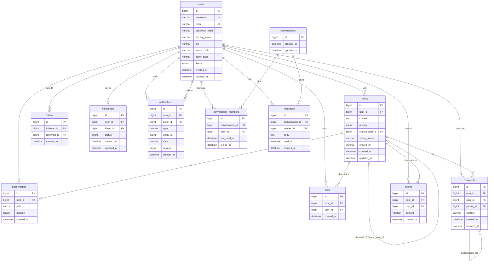

# ERD — Koobecaf Social Network

Sơ đồ quan hệ thực thể của toàn hệ thống. Engine InnoDB, charset `utf8mb4_unicode_ci`.

## Quan hệ và ràng buộc chính

| Quan hệ | Loại | Ghi chú |
|---|---|---|
| `users` – `posts` | 1-n | Xóa user → xóa toàn bộ bài viết (`ON DELETE CASCADE`) |
| `posts` – `post_images` | 1-n | Xóa bài viết → xóa ảnh |
| `posts` – `likes` | 1-n | UNIQUE `(post_id, user_id)` chống like trùng |
| `posts` – `comments` | 1-n | `parent_id` tự tham chiếu cho reply |
| `posts` – `shares` | 1-n | UNIQUE `(post_id, user_id)` chống chia sẻ trùng |
| `posts` – `posts` | 0-1 | `shared_post_id` trỏ tới bài gốc |
| `users` – `follows` | n-n | UNIQUE `(follower_id, following_id)` + CHECK không tự follow |
| `users` – `friendships` | n-n | UNIQUE `(user_id, friend_id)` + CHECK không tự kết bạn |
| `conversations` – `conversation_members` | 1-n | UNIQUE `(conversation_id, user_id)` |
| `conversations` – `messages` | 1-n | Chỉ thành viên mới đọc được tin nhắn |
| `users` – `notifications` | 1-n | UNIQUE `(user_id, actor_id, type, entity_id)` chống thông báo lặp |

## Quyền riêng tư bài viết

| `privacy` | Ai xem được |
|---|---|
| `public` | Mọi người (kể cả khách chưa đăng nhập) |
| `followers` | Người theo dõi + chủ bài viết + bạn bè đã chấp nhận |
| `private` | Chỉ chủ bài viết |
